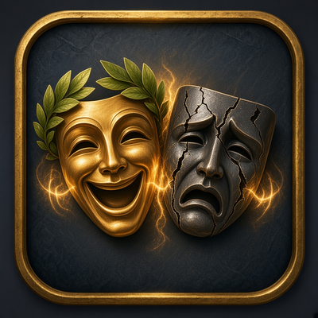
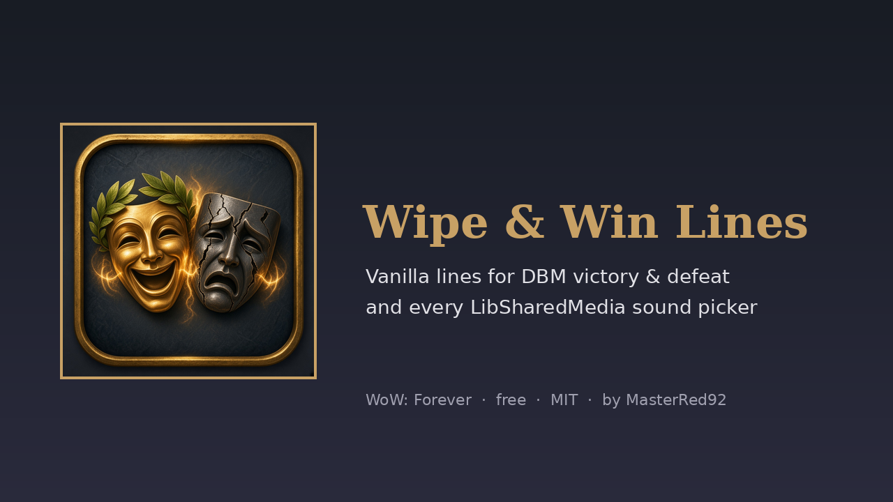
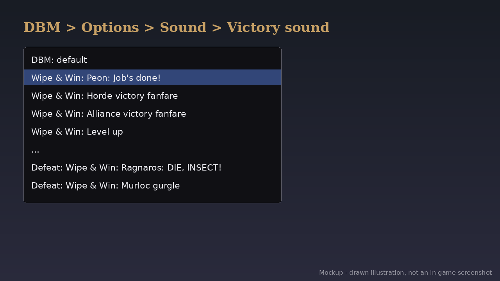

# Wipe & Win Lines (WoW: Forever) v1.0.0

   

DBM can play a sound when you kill a boss and another when you wipe. **Wipe & Win Lines** adds vanilla lines to those lists, so a kill can end with the peon's "Job's done!" or the PvP victory fanfare, and a wipe with Ragnaros' "DIE, INSECT!" or a murloc gurgle.

- **DBM:** the lines show up in DBM > Options > Sound > Victory/Defeat sound, next to DBM's own. They're loaded through DBM's own sound-pack hook.
- **LibSharedMedia:** the same lines are registered as LSM sounds, so BigWigs, WeakAuras and anything else with an LSM sound picker can use them.
- **Nothing bundled:** every line is a sound that's already in the WoW: Forever client, played by its sound ID.
- `/wipewin` lists the lines, and `/wipewin win 1` or `/wipewin wipe 3` previews one (not in combat).

**Needs:** Optional: [DBM](https://www.curseforge.com/wow/addons/deadly-boss-mods) (victory and defeat lists) and any addon that uses LibSharedMedia sounds, such as BigWigs.

## Download
- **Wago Addons:** coming at launch (Nov 4). The link goes here when the project is live.
- **CurseForge:** maybe later.
- **GitHub:** [Releases](https://github.com/masterred92/WipeAndWin/releases) (from the first tagged release) · [Issues](https://github.com/masterred92/WipeAndWin/issues)
- **More by Kenny:** [BRBoss](https://github.com/masterred92/BRBoss) · [GruntCount](https://github.com/masterred92/GruntCount) · [FloorIsLava](https://github.com/masterred92/FloorIsLava) · [all WoW: Forever addons](https://github.com/masterred92/wow-forever-addons)

## Commands
`/wipewin` list · `/wipewin win N` · `/wipewin wipe N`

## Install
Put the `WipeAndWin` folder in `World of Warcraft\_forever_\Interface\AddOns\` and restart the game or `/reload`.

## In-game test checklist (launch day)
1. Listed in AddOns with its icon.
2. `/wipewin win 1` and `/wipewin wipe 1` play a line. Check each line matches its label.
3. DBM > Options > Sound: the 'Wipe & Win:' lines appear in the Victory and Defeat dropdowns and preview.
4. BigWigs (or another LSM user): 'Wipe & Win:' sounds are in its sound picker.
5. Kill something with a DBM mod (e.g. a dungeon boss) with a Wipe & Win victory line chosen: it plays.

## Licence
MIT. Written from scratch; no code copied from other addons. Free, no paid features. It doesn't automate gameplay: everything it does is a reaction you can see or something you typed.

## Development
`tests/run.sh [path-to-wow-ui-source-forever]` runs `luac -p`, luacheck, the mock-client tests and (with a path) an API check against Blizzard's Forever UI source and the host addons' source. GitHub Actions runs the tests on every push. The release workflow is a manual dry run that builds the zip with [BigWigsMods/packager](https://github.com/BigWigsMods/packager); publishing is switched off until the Wago project ID is added (see the comments in `.github/workflows/release.yml`).
